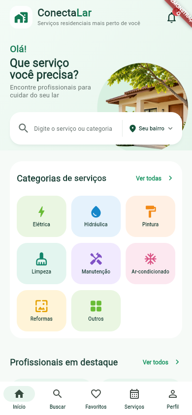
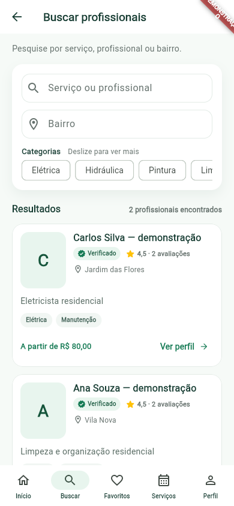
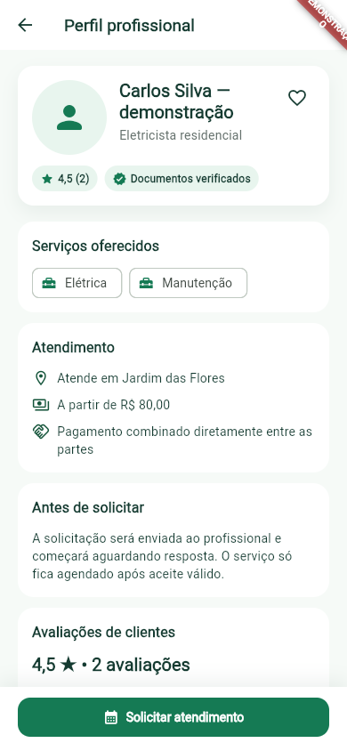
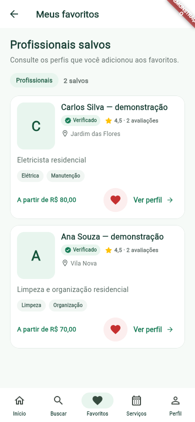
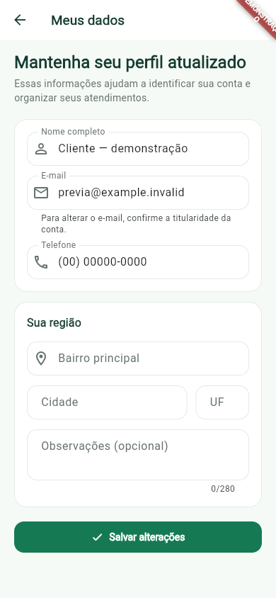
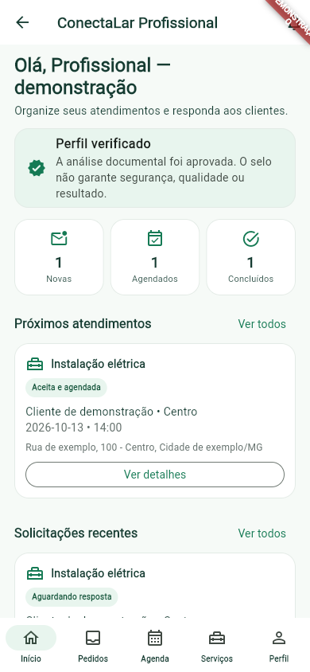
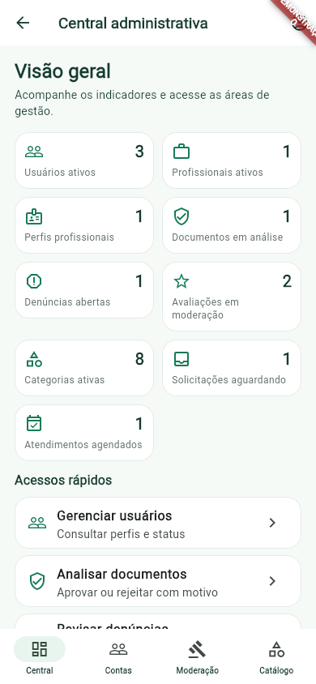

# Conferência visual — evidências disponíveis

Base da conferência: capturas Flutter Web com dados fictícios e auditoria em 360, 390 e 412 pixels lógicos. Nenhuma tela ou componente foi alterado nesta conferência documental. As capturas não substituem API real, aparelho físico ou leitura pixel a pixel dos protótipos.

## Home

Observação: saudação, busca e imagem circular da casa mantêm hierarquia; cartões de destaque e categorias se adaptam às larguras registradas. Testes de widget cobrem texto ampliado em telas específicas.

Capturas: [360](evidencias/home-responsiva-2026-10-11/home-360.png) · [390](evidencias/home-responsiva-2026-10-11/home-390.png) · [412](evidencias/home-responsiva-2026-10-11/home-412.png)

## Busca

Observação: filtros, resultados e cards mantêm leitura nas três larguras; o card foi testado com texto ampliado. Mensagem de estado vazio foi revisada no commit 0264eab.

Capturas: [360](evidencias/cards-profissionais-2026-10-11/busca-360.png) · [390](evidencias/cards-profissionais-2026-10-11/busca-390.png) · [412](evidencias/cards-profissionais-2026-10-11/busca-412.png)

## Perfil público

Observação: hierarquia de identificação, avaliação, selo e ação principal foi ajustada para texto longo. A correção de overflow do selo foi integrada em 0264eab. O estado do favorito em uso real ainda precisa ser confirmado.

Capturas: [360](evidencias/perfil-publico-2026-10-11/perfil-publico-360.png) · [390](evidencias/perfil-publico-2026-10-11/perfil-publico-390.png) · [412](evidencias/perfil-publico-2026-10-11/perfil-publico-412.png)

## Favoritos

Observação: os cards preservam nome, serviço, avaliação e ação nas larguras conferidas. As capturas são da prévia; validar que o estado salvo pela API continue indicado ao reabrir a tela.

Capturas: [360](evidencias/cards-profissionais-2026-10-11/favoritos-360.png) · [390](evidencias/cards-profissionais-2026-10-11/favoritos-390.png) · [412](evidencias/cards-profissionais-2026-10-11/favoritos-412.png)

## Meus dados

Observação: formulário e texto auxiliar de e-mail acomodam a largura testada; testes simulam área reduzida pelo teclado, sem abrir teclado nativo.

Capturas: [360](evidencias/meus-dados-2026-10-11/editar-dados-360.png) · [390](evidencias/meus-dados-2026-10-11/editar-dados-390.png) · [412](evidencias/meus-dados-2026-10-11/editar-dados-412.png)

## Área profissional

Observação: painel responsivo conferido com dados de demonstração. A agenda, solicitações e ações ainda precisam de execução no ambiente real.

Capturas: [360](evidencias/front-end-2026-10-11/profissional-360.png) · [390](evidencias/front-end-2026-10-11/profissional-390.png) · [412](evidencias/front-end-2026-10-11/profissional-412.png)

## Administração

Observação: captura cobre o painel, não cada lista autenticada. Documentos, denúncias, avaliações, usuários, categorias e auditoria precisam de revisão manual por estado.

Capturas: [360](evidencias/front-end-2026-10-11/admin-360.png) · [390](evidencias/front-end-2026-10-11/admin-390.png) · [412](evidencias/front-end-2026-10-11/admin-412.png)

## Limites e próximos passos

- Dados e contas das capturas são fictícios, servidos em modo de demonstração.
- A fonte padrão foi usada nas imagens; texto ampliado está coberto em testes apenas para telas/componentes descritos nas evidências individuais.
- Teclado nativo, leitor de tela, foco, orientação e seletor de arquivos exigem aparelho real.
- Registre problemas encontrados, largura, escala de texto, estado da API e captura correspondente no [checklist visual](homologacao-visual.md).
