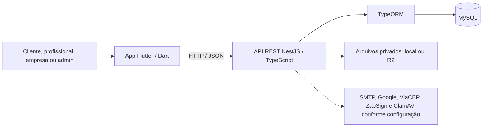

# Ficha técnica — ConectaLar

**Referência:** branch `main`, commit `74e2161`, em 12/11/2026.

**Natureza:** aplicativo de intermediação de serviços residenciais.
**Estado:** núcleo funcional implementado para desenvolvimento e demonstração; beta técnica local preparada para dados fictícios. A operação com clientes e prestadores reais ainda não foi homologada nem liberada.

## 1. Resumo para apresentação

O ConectaLar conecta clientes a profissionais e empresas de serviços residenciais. O cliente busca ofertas, consulta perfis, escolhe endereço e horário e envia uma solicitação. O prestador organiza serviços e disponibilidade, responde ao pedido e acompanha a agenda. A administração gerencia contas, catálogo e moderação. O sistema registra propostas, histórico, chat, avaliações e denúncias. **Solicitar não confirma um agendamento:** o aceite válido precisa passar pela API e pela verificação de disponibilidade e habilitação.

O projeto não processa pagamentos. Preço inicial, orçamento e valor final podem ser informados, mas a combinação e o pagamento ocorrem fora do aplicativo. O selo de documentos indica análise administrativa e não garante segurança ou qualidade do serviço.

## 2. Arquitetura

| Camada | Implementação atual | Papel |
| --- | --- | --- |
| Interface | Flutter, Dart e Material 3; telas, modelos, serviços HTTP e widgets reutilizáveis em `lib/` | Navegação, formulários, apresentação de dados e feedback de uso |
| Aplicação | API REST em NestJS 12 e TypeScript 6, em `apps/api/` | Autenticação, autorização, regras de negócio e contratos HTTP |
| Persistência | MySQL via TypeORM 1.1.2 e `mysql2` 3.24.5 | Contas, perfis, catálogo, pedidos, conversas, documentos, moderação e auditoria |
| Contrato | OpenAPI 3.1 em `apps/api/openapi.yaml` | Rotas e estruturas de requisição e resposta |
| Mídia | Assets Flutter; documentos privados em disco local no desenvolvimento ou Cloudflare R2 configurável | Identidade visual e arquivos de verificação |

O Flutter usa `AppServices` como ponto de acesso aos serviços, `api_mappers.dart` para converter respostas em modelos e `SessionGate` para orientar a navegação por papel. A API valida permissões no servidor. O banco usa migrations explícitas; `synchronize` e `migrationsRun` estão desativados.

O repositório também guarda `backend/` em PHP e `database/conectalar.sql` como **legado histórico**. A API usada pelo app atual é a de `apps/api/`; o SQL legado não deve ser importado no banco NestJS.

## 3. Tecnologias e plataformas

| Item | Definição no repositório |
| --- | --- |
| App | Flutter; Dart SDK `^3.10.7`; versão declarada `1.0.0+1` |
| Dependências principais do app | `http`, `flutter_secure_storage`, `file_selector`, `pdfrx`, `geolocator`, `google_maps_flutter`, `google_sign_in`, `share_plus` |
| API | Node.js `^22.13.0` ou `>=24.15.0`; NestJS 12.2.0; TypeScript 6.0.2 |
| Banco | MySQL; TypeORM 1.1.2; migrations versionadas |
| Android | `applicationId` e namespace `br.com.conectalar.app`; Java/Kotlin 17; Gradle 9.5.0; versão e SDK alvo derivados do Flutter |
| Plataformas com projetos no repositório | Android, iOS, Web, Linux, macOS e Windows; a homologação recente concentra-se em Android e build Web |
| Tema | Material 3; verdes oficiais `#157A54` e `#15553B`, fundo `#F6FAF7`, texto `#153B31`; tokens de espaçamento e raio em `lib/app/theme.dart` |

## 4. Tipos de conta e módulos

| Papel | Recursos implementados na interface e na API |
| --- | --- |
| Cliente | Cadastro, confirmação de e-mail, login, dados, endereços, Home, busca, filtros, distância, favoritos, perfil público, solicitação, pedidos, chat, conclusão, avaliação, denúncia e notificações |
| Profissional | Perfil, foto, serviços/ofertas, escopo da oferta, disponibilidade, agenda, pedidos recebidos, propostas, documentos, verificação, chat, avaliações recebidas e configurações |
| Empresa | Cadastro e perfil como prestador, ofertas e agenda do perfil; **cadastro de cada executor, vínculo e habilitação individual ainda não estão implementados** |
| Administrador | Painel, usuários, criação de outros administradores por convite, categorias, documentos, habilitações, denúncias, avaliações, histórico, auditoria e MFA |

Recursos compartilhados incluem recuperação e troca de senha, logout com invalidação de token, aceite de termos, edição de dados permitidos, exportação de dados pessoais e exclusão/anonimização da conta. A prévia visual separada da API usa dados fictícios e pode simular cliente, profissional, empresa e administrador.

### Fluxo principal do atendimento

1. O cliente seleciona uma oferta ativa, informa endereço cadastrado, descrição, data e horário e cria um pedido `aguardando_resposta`. O endereço completo permanece protegido pelas regras da API.
2. O profissional aceita ou recusa; também pode enviar uma proposta formal de horário ou escopo. O cliente pode responder à proposta. Chat comum não confirma agendamento.
3. Antes de confirmar, a API revalida habilitação, duração, disponibilidade e conflitos de agenda. O aceite válido gera `aceita_agendada`.
4. Após o aceite, há reagendamento, orçamento, chat, cancelamento, indicação/contestação de conclusão e avaliação conforme o estado e as permissões.
5. O histórico preserva eventos e versões relevantes do combinado. A oferta inclui listas opcionais de inclusões, exclusões e opcionais; o pedido guarda uma cópia do escopo na criação.

A decisão P06 usa horário civil de `America/Sao_Paulo`, duração definida por oferta, **120 minutos para serviços legados** e **um atendimento simultâneo por perfil**, inclusive empresa. Novas ofertas não exigem intervalo adicional; pedidos antigos preservam seu intervalo histórico. O pedido pendente não reserva vaga. A API oferece horários públicos que comportam a duração do serviço e revalida no aceite.

Os prazos implementados incluem 48 horas para a primeira resposta do profissional, encerramento no horário solicitado se ele chegar antes, 48 horas para o cliente responder às propostas aplicáveis e 96 horas sem ação formal antes do aceite. Orçamento ou reagendamento vencido após o aceite preserva o combinado anterior. O cancelamento aceito antes do início exige motivo; uma solicitação do cliente com menos de 24 horas fica identificada como excepcional, sem multa interna.

**Estados:** a referência funcional original lista cinco estados principais. O código atual registra oito valores: `aguardando_resposta`, `aceita_agendada`, `recusada`, `cancelada`, `conclusao_pendente`, `conclusao_contestada`, `nao_comparecimento_informado` e `conclusao_confirmada`. As três situações adicionais de conclusão/ocorrência precisam ser reconciliadas na documentação de requisitos antes da apresentação como escopo formal aprovado.

## 5. API e dados

Na revisão desta ficha, o OpenAPI contém **102 caminhos**, **118 operações HTTP** e **19 schemas**; são números do contrato versionado, não uma contagem de fluxos homologados. A estrutura do banco possui **28 classes de entidade** e **40 migrations** no repositório. A migration mais recente é `1760139000000-AgendaSemIntervalo`.

| Grupo de dados | Exemplos persistidos |
| --- | --- |
| Identidade e acesso | Usuários, verificação de e-mail, recuperação de senha, convites admin e aceite de termos |
| Cliente e prestador | Perfis, endereços, favoritos, ofertas, disponibilidade, bloqueios de agenda e documentos |
| Atendimento | Solicitações, eventos, propostas, orçamentos, reagendamentos, mensagens e notificações |
| Confiança e governança | Avaliações, denúncias, verificação de identidade/telefone, auditoria administrativa e solicitações de privacidade |

Há endpoints de vida do processo (`/health` e `/health/live`) e de prontidão (`/health/ready`). A prontidão verifica configuração, conexão TypeORM e resposta do MySQL; não substitui a conferência de migrations, SMTP, storage, Google ou antivírus.

## 6. Segurança, privacidade e integrações

- Senhas são derivadas com `scrypt`; os tokens Bearer são assinados no servidor e podem ser invalidados por versão da conta. A sessão Flutter usa armazenamento seguro da plataforma.
- O login administrativo exige MFA TOTP para rotas protegidas. Papéis e vínculo com cada recurso são conferidos na API; a navegação Flutter também orienta o acesso.
- O endereço completo do cliente é controlado por estado, participação e habilitação. Documentos são acessados por rota administrativa autenticada; upload aceita PDF, JPEG e PNG de até 5 MB.
- A API oferece CORS configurável, cabeçalhos básicos de segurança, respostas de erro filtradas, auditoria, limites persistidos para códigos de autenticação e rate limit por IP **em memória de cada processo**.
- Exportação autenticada em JSON e exclusão/anonimização de conta estão implementadas. Inventário de dados, retenção, descarte, contratos de fornecedores e revisão jurídica final ainda não estão aprovados.
- Integrações configuráveis: Google OAuth, Google Maps/Geocoding, ViaCEP, SMTP, Cloudflare R2, ClamAV e ID ZapSign. Código existente ou configuração possível não comprova credenciais ativas nem homologação real do fornecedor.
- Há notificações internas e e-mails transacionais configuráveis. Push com aplicativo fechado ainda não está ativo.

## 7. Identidade visual, experiência e demonstração

O app usa a marca da casa ConectaLar, ícone Android, imagem de fachada na Home, cartões de categorias e profissionais, componentes compartilhados de formulário e estados visuais de carregamento, erro e lista vazia. Busca manual, GPS sob ação do usuário e mapa Android aproximado fazem parte da experiência; mapa e login Google reais dependem de credenciais restritas.

A demonstração visual pode rodar com `CONECTALAR_DEMO=true`, identificada no app e sem persistir operações na API. Para exercitar pedidos fictícios com API/MySQL, existe uma **beta técnica local** controlada por `NODE_ENV=test`, banco descartável `conectalar_beta_test` em loopback, flag específica e IDs de perfis fictícios permitidos. Fora dessas condições, `podeAtender=false` e novos pedidos/aceites continuam bloqueados. A beta não habilita atendimentos reais.

## 8. Qualidade e estágio de entrega

O registro mais recente em `docs/homologacao-beta-local.md` informa, para 12/11/2026: **136 testes automatizados da API**, **304 testes Flutter**, build Web e APK debug gerados. `flutter analyze --no-pub` não apontou erros ou avisos de código e registrou 124 mensagens informativas de depreciação no Flutter 3.50. **Esses comandos não foram repetidos para criar esta ficha.** A evidência citada pertence ao commit de referência.

Há testes de widgets e de API, além de testes de integração que exigem MySQL isolado. A última beta ainda não teve a migration nova e o fluxo completo validados em MySQL descartável nem foi conferida em aparelho Android físico; nenhum item de homologação manual foi marcado. Existem checklists por papel. Não há workflow CI executável em `.github/workflows/`; `docs/proposta-ci-cd.md` é uma proposta.

### Para apresentar o estágio com precisão

| Situação | Evidência ou limite |
| --- | --- |
| Código funcional | Telas Flutter, API, entidades, migrations, OpenAPI e testes automatizados presentes |
| Demonstração visual | Prévia com dados fictícios disponível sem API |
| Beta integrada | Preparada para teste local isolado com contas e banco descartáveis; homologação manual ainda pendente |
| Atendimento real | Bloqueado pela política de habilitação ainda incompleta |
| Publicação | Pendente de ambiente HTTPS, credenciais, storage/antivírus, assinatura release, backups, monitoramento, testes físicos e revisão jurídica |

## 9. Pendências prioritárias

1. **Segurança do prestador:** fechar critérios de identidade, telefone, comprovante profissional e antecedentes; modelar e verificar cada executor de empresa; aprovar o fluxo de dois administradores distintos com MFA. A aprovação atual não habilita atendimento.
2. **Homologação integrada:** aplicar migrations atuais em MySQL descartável, percorrer cliente, profissional, empresa e admin em Android físico e testar permissões, agenda, propostas, arquivos, rede instável e acessibilidade.
3. **Catálogo e operação:** validar a ficha de limpeza, inclusões/exclusões/opcionais, mudanças no combinado, incidentes e casos excepcionais; a ficha de limpeza no repositório ainda é proposta.
4. **Privacidade e fornecedores:** concluir inventário, bases e prazos de guarda, descarte, contratos, avisos e revisão jurídica antes de tratar dados reais de habilitação.
5. **Lançamento:** definir domínio e HTTPS, credenciais Google, R2 e ClamAV de produção, backup/restauração, monitoramento, CI/deploy, chave e assinatura Android release e homologação do artefato final.

## Fontes principais do próprio repositório

- [Visão geral](../README.md), [dependências Flutter](../pubspec.yaml) e [rotas Flutter](../lib/app/routes.dart).
- [Pacote da API](../apps/api/package.json), [módulos NestJS](../apps/api/src/app.module.ts), [OpenAPI](../apps/api/openapi.yaml) e [configuração do banco](../apps/api/src/database/database.config.ts).
- [Decisões](decisoes.md), [agenda](agenda-duracao.md), [prazos e cancelamento](politica-operacional-pedidos-propostas.md) e [habilitação](habilitacao-profissional.md).
- [Beta e resultados registrados](homologacao-beta-local.md), [preparação Android](preparacao-android-release.md), [inventário de dados](inventario-dados-e-fornecedores.md) e [política de habilitação proposta](proposta-politica-habilitacao-profissional.md).
